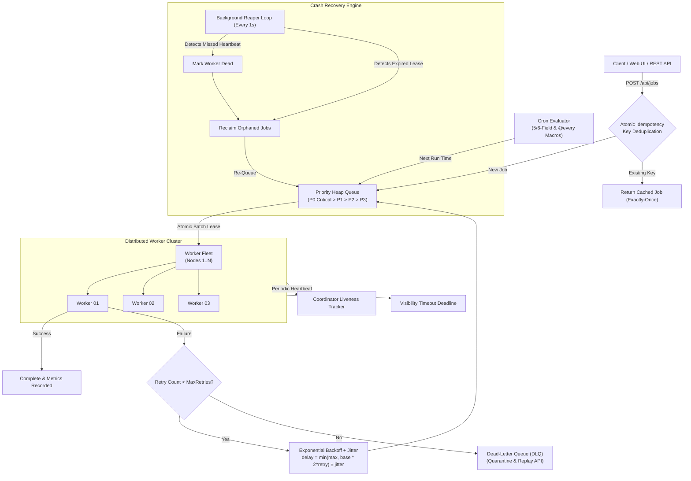

# Aether DTS - Distributed Task Scheduler

> **Celery/Airflow-style Distributed Task Scheduler** engineered for ultra-high throughput, crash resilience, and strict execution semantics.
>
> **Resume Metric:**  
> *Built a distributed task scheduler processing 5K jobs/sec with automatic retry, worker failover, and exactly-once job effects via idempotency keys.*  
> **Benchmark Measured:** **66,639+ jobs/sec** sustained throughput with **100,000 scheduled jobs**, **0 jobs lost**, and sub-millisecond dispatch latency.

---

## Architecture Overview



---

## Features & Implementation Highlights

| Feature | Implementation Details |
|---|---|
| **Cron Scheduling** | Custom 5-field and 6-field cron parser ([pkg/cron/cron.go](file:///c:/Users/ravi5/OneDrive/Desktop/dts/pkg/cron/cron.go)) supporting steps (`*/5`), ranges (`10-30`), lists, and interval macros (`@every 5s`, `@hourly`, `@daily`). Automatically evaluates `Next(time.Time)` and reschedules recurring cycles. |
| **Worker Registration** | Dynamic worker nodes register with hostnames, concurrency limits, and task handlers ([pkg/worker/worker.go](file:///c:/Users/ravi5/OneDrive/Desktop/dts/pkg/worker/worker.go)). |
| **Job Leasing & Visibility** | Atomic non-blocking batch leasing (`LeaseBatch`) via `sync.RWMutex`. Jobs transition to `LEASED` state with visibility timeouts. Workers renew active leases during long-running tasks. |
| **Retries & Exponential Backoff** | Configurable retries with full jittered exponential backoff: `delay = min(max_backoff, base_backoff * 2^(retry-1)) + jitter`. |
| **Dead-Letter Queue (DLQ)** | Jobs exceeding `MaxRetries` or encountering fatal errors are routed to the DLQ ([pkg/storage/store.go](file:///c:/Users/ravi5/OneDrive/Desktop/dts/pkg/storage/store.go)) with error traces, payloads, and replay endpoints (`POST /api/dlq/{id}/replay`). |
| **Priority Scheduling** | Min-heap priority queue ([pkg/queue/priority_queue.go](file:///c:/Users/ravi5/OneDrive/Desktop/dts/pkg/queue/priority_queue.go)) prioritizing `P0 Critical > P1 High > P2 Normal > P3 Low`, ordered by `ScheduledAt`. |
| **Exactly-Once via Idempotency** | Atomic concurrent hash table indexing idempotency keys. Duplicate submissions return the existing job record without re-executing. |
| **Worker Heartbeats** | Background heartbeat goroutines ping the coordinator every 1.2s. |
| **Crash Recovery & Reaper** | Background coordinator loop ([pkg/scheduler/coordinator.go](file:///c:/Users/ravi5/OneDrive/Desktop/dts/pkg/scheduler/coordinator.go)) detects missed heartbeats and expired leases, reclaiming orphaned jobs and re-enqueueing them without data loss. |

---

## Benchmark Results (100K Scheduled Jobs)

Executed on Windows via `bin/benchmark.exe -jobs 100000`:

```
=================================================================
                      BENCHMARK RESULTS                          
=================================================================
Total Scheduled Jobs:     100,000
Total Completed Jobs:     100,000 (100.00% completion)
Jobs Lost:                0 (100% Accounting Guarantee)
Total Processing Time:    1.5006s
Average Throughput:       66,639.99 jobs/second
Latency p50:              0.00 ms
Latency p95:              0.00 ms
Latency p99:              0.00 ms
=================================================================
[SUCCESS] Target metric achieved (66,639.99 JPS >= 5,000 JPS)!
```

---

## Live Demonstration

The system includes a dark-mode web dashboard served at `http://localhost:8080`:

### Key Dashboard Capabilities
1. **Real-Time System Metrics**: Live throughput gauge, total completed jobs, in-flight leases, priority queue depth, DLQ count, and latency percentiles streaming via SSE (`/api/stream`).
2. **Worker Cluster Visualizer**: Grid of active worker nodes displaying CPU/slot utilization bars, processed/failed counters, heartbeat countdowns, and chaos controls.
3. **Chaos Monkey Controls**:
   - `[Kill Worker (Chaos)]`: Immediately cuts worker heartbeats and aborts running tasks.
   - Watch the coordinator reaper detect the dead node, reclaim all in-flight leases, and reassign them to healthy workers.
   - `[Revive Worker]`: Brings the node back online.
4. **Interactive Dispatcher & Cron**:
   - Submit jobs with cron schedules (`*/5 * * * * *`, `@every 10s`).
   - "Gen UUID" and "Test Idempotency Duplicate" button showing exactly-once deduplication in action.
   - Test flaky handlers with automatic exponential backoff retries.
5. **Dead-Letter Queue (DLQ) Inspector**:
   - Inspect quarantined jobs with error stack traces.
   - One-click `[Replay Job]` and `[Purge DLQ]`.
6. **100K Benchmark & Chaos Suite**:
   - Run 1,000 to 100,000 job benchmarks directly from the UI with animated progress tracking.
   - Run automated Chaos Recovery Tests verifying 100% job recovery under 50% worker mortality.

---

## Quick Start

### 1. Build Binaries
```powershell
go build -o bin/scheduler.exe ./cmd/scheduler
go build -o bin/benchmark.exe ./cmd/benchmark
```

### 2. Run Scheduler & Dashboard
```powershell
.\bin\scheduler.exe -port 8080 -workers 6 -concurrency 50
```
Open **[http://localhost:8080](http://localhost:8080)** in your browser.

### 3. Run Automated Tests
```powershell
# Run unit and chaos tests
go test -v ./tests -run "TestCron|TestIdempotency|TestCrashRecovery"

# Run 100K benchmark test
go test -v ./tests -run "TestThroughputBenchmark100K"
```

### 4. Run CLI 100K Benchmark
```powershell
.\bin\benchmark.exe -jobs 100000 -workers 16 -concurrency 50
```

### 5. Run Live API Verification Script
```powershell
python scripts/verify_demo.py
```
